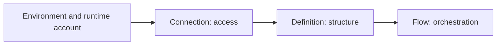

A Data Connection is a reusable Velox module that describes how to reach data. Velox has two confirmed connection kinds: **DB Connection** for databases and **File Connection** for files and folders.

## Why Connections are separate

Separating access configuration from data structure lets several Definitions and Flows reuse the same resource settings. It also gives administrators one place to update a folder or database connection when a deployment changes.

This reuse creates a shared dependency. Before changing a Connection, check which Definitions, Flows, Maps, Reports or other modules use it.

## DB Connections

A DB Connection holds the information Velox needs to create database connections, such as the selected database type, network location, database name and authentication options. DB Definitions and database-backed processing use the connection through Velox connection pools.

The product contains configuration paths for several database technologies, but actual support depends on the drivers and components installed in the selected distribution. Confirm the approved compatibility matrix before deploying a particular database, driver or authentication method.

Use **Test** in the DB Connection setup, then verify the connection again under the Windows account that runs the applicable Velox service. An interactive Designer test does not prove that a service account has the same network or database access.

## File Connections

A File Connection describes folders, filename patterns and file-lifecycle behaviour. File Definitions use it to locate structured files. Flow monitoring, file routing and some Transport workflows also depend on File Connections.

Paths must be accessible to the process that performs the work. For background execution, test access as the Velox Service account. Prefer stable absolute or approved network paths, and ensure that input, output, archive and error locations cannot unintentionally overlap.

## How Connections fit into processing

The Connection supplies access, the Definition supplies a structured view, and the Flow decides when and how to use that data. The selected test or production context and the execution host determine which environment and permissions apply.

## Security and operational considerations

- Store credentials through approved product and operating-system controls; never place secrets in documentation or examples.
- Grant only the database, folder and network access required by the integration.
- Changing a shared Connection can affect several active Flows.
- Test database writes and file moves with non-production data before enabling background processing.
- Treat connection-test success as one check, not end-to-end proof of a complete integration.

## Related tasks

- [Configure a DB Connection](database/index.md)
- [Configure a File Connection](file/index.md)
- [Data Definition concepts](../data-definitions/definition-concepts.md)
- [Troubleshoot data Connections](../../operate-and-troubleshoot/connection-troubleshooting.md)
