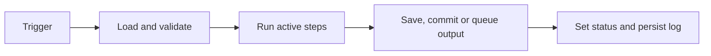

A Flow is the Velox configuration that coordinates data, processing steps, triggers and completion behaviour. Implementers design Flows in Velox Designer; Designer, Velox Service or Velox API Service executes them according to the selected trigger.

## Flow configuration

A Flow can combine:

- Definition-backed data and runtime parameters;
- ordered, active Flow steps;
- manual, scheduled, monitored or REST execution;
- concurrency and retry settings;
- logging and notification policy; and
- sub-Flow or successor-Flow relationships.

The Flow refers to reusable modules rather than copying all their configuration. Check these dependencies before moving or changing a Flow.

## Flow data

Flow data items make DB Definitions and File Definitions available during execution. Parameters and runtime values can select or constrain data. Steps can read, transform and write definition-backed data according to their configuration.

Opening and saving data can have database or file side effects. Test with controlled data and verify transaction, output and cleanup behaviour before enabling background execution.

## Flow steps

Active steps execute in their configured order. Confirmed step families include Maps, Reports, scripts, outbound Transports, file routing, command-line work, custom SQL and sub-Flows.

Step success contributes to the Flow result. Error, cancellation, continuation and retry settings can change what happens after a step fails, so the absence of a stopped process does not necessarily mean every intended output was created.

Some product internals and older fields call a Flow an **Action**. In user-facing guidance, **Flow step** means an operation inside the Flow; it does not mean the Flow itself.

## Triggers

| Trigger | Host | Key dependency |
| --- | --- | --- |
| Manual run or Test Run | Designer | Current context and interactive user permissions |
| Schedule | Velox Service | Active schedule and running, enabled service |
| File monitor | Velox Service | Accessible File Connection and monitor settings |
| Inbound Transport | Velox Service | Active Transport and local processing configuration |
| REST request | Velox API Service | REST-enabled Flow and approved API deployment |
| Sub-Flow | Current Flow host | Valid target Flow and safe relationship |

Scheduled, monitored and Transport work can run concurrently. Configure concurrency deliberately and ensure shared files, database rows and external systems can handle overlapping work.

## Execution lifecycle

At a high level, Velox loads the Flow and its dependencies, validates and opens data, executes active steps, saves or commits output, queues outbound Transport work, determines the final status and persists the configured log.

Outbound sending is asynchronous: a Flow can create a Transport queue item that Velox Service sends later. Use Transport Logs as well as the Flow log to verify delivery.

## Completion, retry and cancellation

Flows can be configured to log selected statuses, send notifications and retry some failed execution. Outbound Transport retry is a separate mechanism from Flow retry.

Retry can repeat external effects. Before enabling it, confirm that database writes, file operations, API calls and downstream processing are safe to repeat. Linked-Flow failure and cycle behaviour requires scenario-specific verification, so do not rely on untested chains for recovery.

## Related tasks

- [Create and configure a Flow](create-flow.md)
- [Configure Flow data items](data/index.md)
- [Configure Flow steps](steps/index.md)
- [Run and test a Flow manually](triggers/manual-runs.md)
- [Schedule a Flow](triggers/schedules.md)
- [Monitor files with a Flow](triggers/file-monitors.md)
- [Flow runtime semantics](runtime/index.md)
- [Review Execution Logs](../../operate-and-troubleshoot/execution-logs.md)
